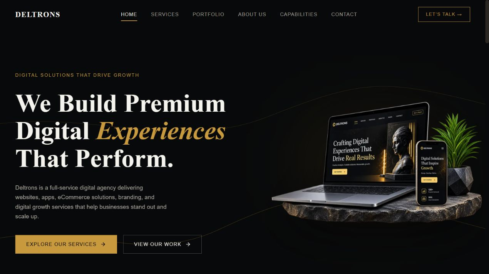

# ✨ Deltrons — Digital Agency Website

A responsive digital agency website built with Next.js and Tailwind CSS.
It presents Deltrons' services, capabilities, portfolio, and brand story
through a dark visual design with gold accents and subtle motion.



> **Showcase project:** The portfolio entries and capability previews are
> sample content. The contact form demonstrates the interface but does not
> send a message to a backend.

## 🌟 Highlights

- Responsive homepage with a device showcase, agency overview, and calls to action
- Service pages covering websites, apps, eCommerce, branding, design, and marketing
- Interactive capability selector with visual previews
- Portfolio, about, and contact pages
- Mobile navigation and scroll reveal effects
- Reusable cards, buttons, layout components, and design tokens

## 🧰 Tech stack

| Area | Tools |
| --- | --- |
| Framework | Next.js 14 (App Router), React 18 |
| Styling | Tailwind CSS 3 |
| Icons | Lucide React |
| Typography | Playfair Display and Inter via `next/font` |

## 🚀 Run locally

**Prerequisite:** Node.js and npm.

1. Install dependencies:

   ```bash
   npm install
   ```

2. Start the development server:

   ```bash
   npm run dev
   ```

3. Open [http://localhost:3000](http://localhost:3000).

For a production build:

```bash
npm run build
npm run start
```

No environment variables or external services are needed to browse the site.

## 🗺️ Pages

| Route | Content |
| --- | --- |
| `/` | Hero, agency metrics, services, values, and capability previews |
| `/services` | Digital services |
| `/capabilities` | Interactive capability showcase |
| `/portfolio` | Sample portfolio projects |
| `/about` | Agency story |
| `/contact` | Contact details and demo form |

## 📂 Project structure

| Path | Purpose |
| --- | --- |
| `app/` | Pages, layout, and global styles |
| `components/home/` | Homepage sections |
| `components/layout/` | Header, mobile menu, footer, and containers |
| `components/capabilities/` | Capability selector and previews |
| `components/contact/` | Contact form UI |
| `data/` | Service, capability, and portfolio content |
| `public/images/` | Hero and service images |

## ⚠️ Demo notes

The contact form shows a local success state only. Capability previews are
illustrative UI examples, and the portfolio entries are sample projects.
Social links in the footer are placeholders until real profiles are added.
